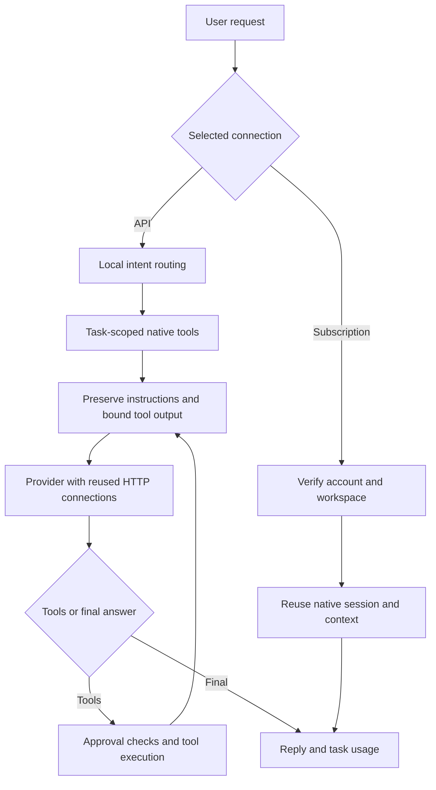

# Runtime efficiency changes

Asrār now sends each API task a smaller tool menu and bounds repeated tool output before every model request. Subscription tasks continue through their native runtimes and reuse native sessions. The changes reduce repeated work without adding mandatory planner, classifier, reviewer, or summarizer model calls.

## Request flow



Both buffered and streamed API execution use `core/runtime.py` for request shaping and usage accounting. Each task has its own context variable and tool catalog. Concurrent requests cannot enable tools or add usage to another task.

## What changed

- **Tool menus:** Chat and reasoning start with skill loading and `discover_tools`; coding, research, document and system tasks start with relevant native functions. `discover_tools(category)` makes additional tools available on the following model call. Categories include files, code, web, git, system, packages, models, skills, planning and all. Discovery does not run actions or bypass permissions. Broad or unusual tasks may need one additional discovery round.
- **Context:** Each provider request applies a default soft budget of 48,000 context characters. Tool outputs retain useful beginnings and endings, with older output reduced first. A single result is capped at 16,000 characters. Full user instructions and tool-call arguments/IDs remain intact. Long conversational history compacts complete turns and pins earlier user requirements; required context may exceed the soft budget. The execution transcript itself is not modified. If source text was omitted, the agent can reread the relevant file.
- **Routing:** Explicit operations take precedence over incidental keywords. A website build stays a coding task; a report mentioning Python remains document work. Referential follow-ups preserve task context, while an explicit new task escapes a pending clarification. Manual model selection remains authoritative. Clear requests avoid the optional hybrid classifier.
- **Native sessions:** Codex reuses a loaded thread while its account, workspace and settings match. Task startup can reuse an account-scoped model catalog for up to 60 seconds; explicit catalog refresh remains live. Account checks still run each turn. Restarts, unloads and configuration changes invalidate reuse. Claude's default-model path skips an unused model-discovery client; explicit overrides are still validated.
- **HTTP connections:** FastAPI owns pooled API clients and closes them at shutdown. Pools are isolated by event loop, provider, endpoint, credential fingerprint and timeout. Headers remain request-local. Standalone scripts retain automatically closed clients. Stream cancellation closes the response and keeps an otherwise usable connection pool available.
- **Usage:** API task results and SSE terminal events include request counts, provider-reported tokens when available, estimated input size, context characters avoided and timing. The activity panel shows the estimates. SQLite execution logs record `runtime_usage` events. Estimates use characters divided by four and are not billable-token counts; some compatible providers omit streaming usage.

The configured models, credentials, conversation database and approval rules are preserved. No silent subscription-to-paid-API fallback is introduced. Existing repeated-work detection, bounded retries and side-effect replay prevention remain active.

## Reproduce the checks

```sh
python3 -m unittest discover -s tests -v
python3 scripts/benchmark_runtime.py
cd frontend && npm run build:web
```

The benchmark makes zero provider requests. It compares a full tool catalog with scoped menus, then replays eight synthetic coding requests with large source/log results, using the same current system prompt on both sides.

| Offline measurement | Before | After |
| --- | ---: | ---: |
| Initial chat tool-schema characters | 14,103 | 815 |
| Initial coding tool-schema characters | 14,103 | 8,565 |
| Initial research tool-schema characters | 14,103 | 1,717 |
| Eight-request estimated input tokens | 331,900 | 102,788 |
| Final synthetic context characters | 340,440 | 47,631 |
| Codex follow-up setup RPCs, excluding turn/start | 3 | 1 |

The synthetic coding example reduces estimated input by **69.0%**. This is request-size evidence, not a measured reduction in vendor bills or real task latency. The native protocol fixture verifies fewer setup requests. Live task speed and quality still depend on the selected model, provider and workload.

`ASRAR_CONTEXT_MAX_CHARS` changes the soft context budget. Routing remains local by default (`ASRAR_ROUTING_MODE=fast`); optional hybrid classification and experimental speculative racing retain their existing opt-in settings. Restart the backend after applying these changes; rebuild/reload the frontend to display new usage information.

## Implementation references

- [OpenAI latency optimization](https://developers.openai.com/api/docs/guides/latency-optimization)
- [OpenAI agent cost and quality evaluation example](https://developers.openai.com/cookbook/examples/agent_optimization/optimizing_agents_for_cost_and_quality)
- [Codex App Server](https://learn.chatgpt.com/docs/app-server)
- [HTTPX asynchronous client lifecycle](https://www.python-httpx.org/async/)
